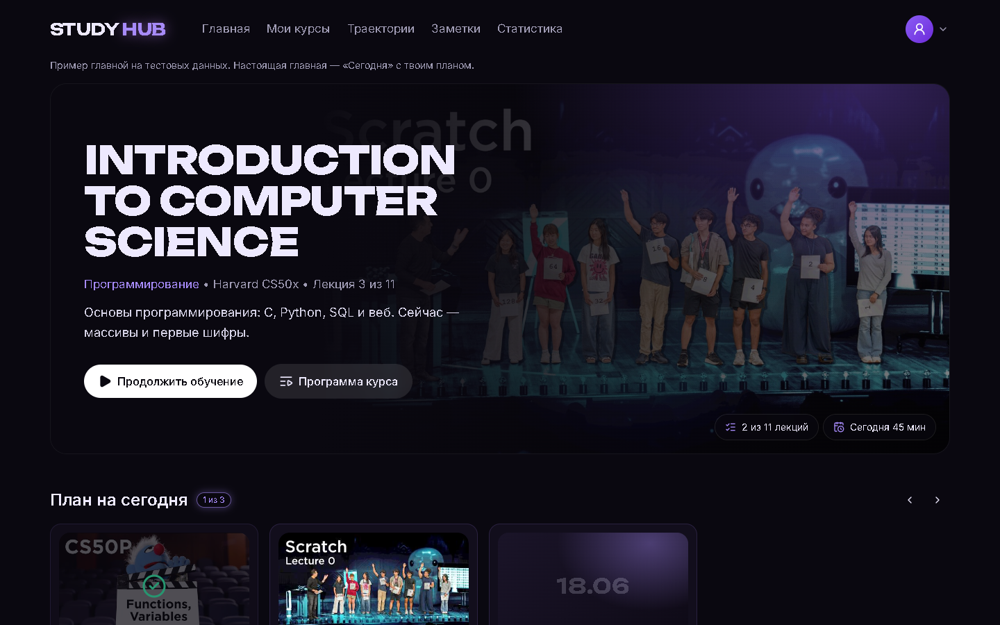
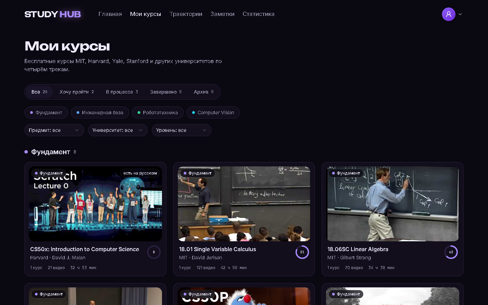
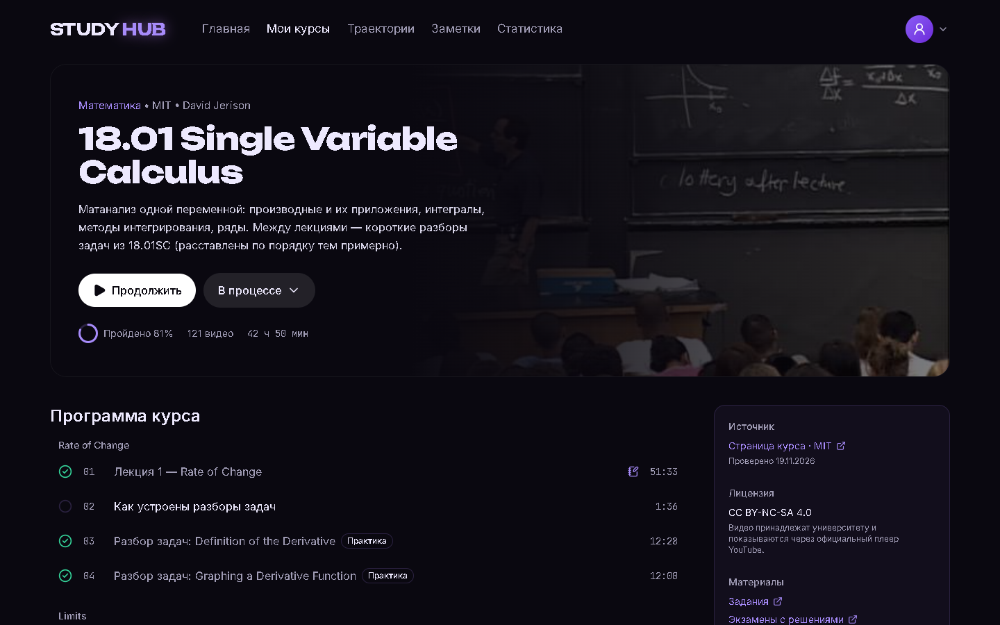
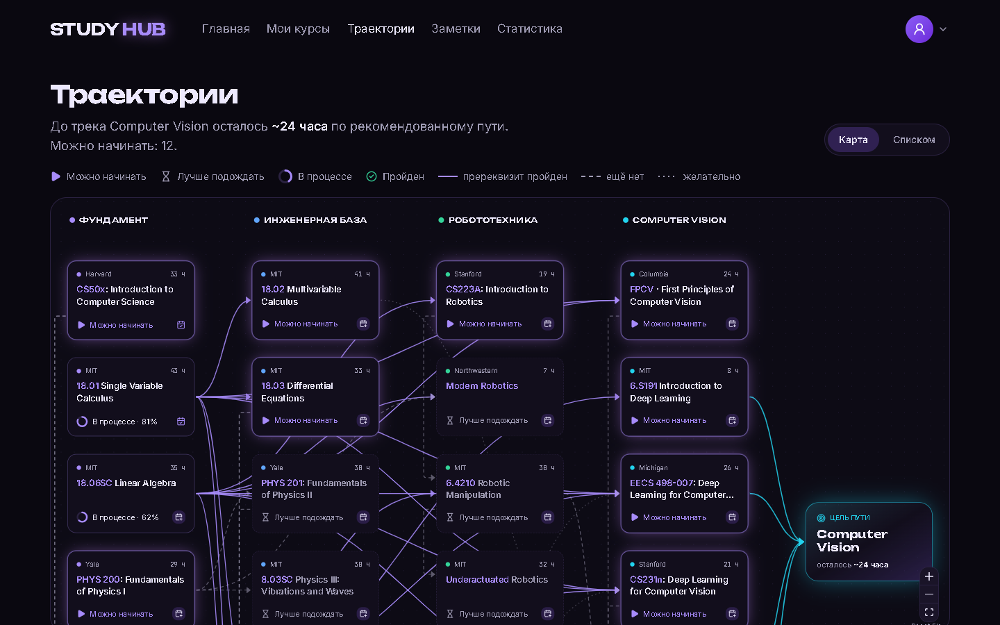
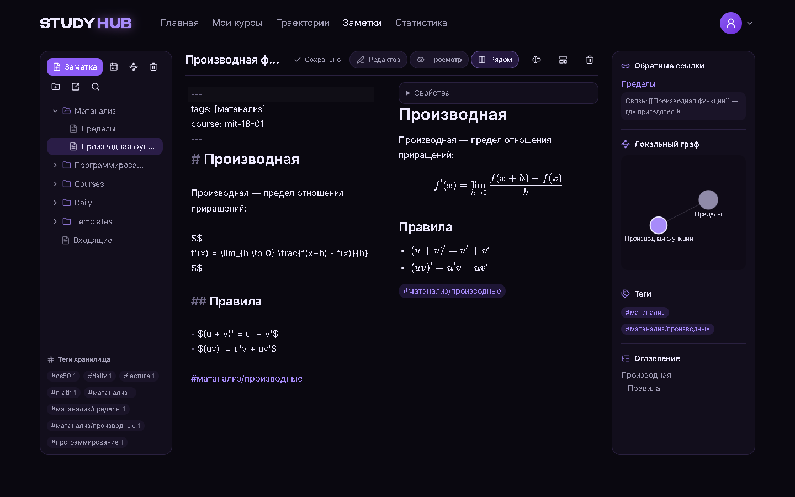
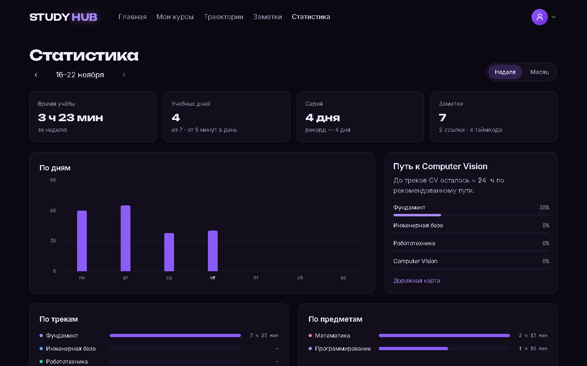

# Study Hub

Личная учебная платформа на пути «фундамент → инженерная база → робототехника → Computer Vision».
Бесплатные видеокурсы MIT, Harvard, Stanford и других университетов, план на каждый день и
конспекты в Obsidian — в одном локальном приложении.

> Версия 1.0. Всё из [`SPEC.md`](SPEC.md) готово; как шла работа — в [`PROGRESS.md`](PROGRESS.md).



## Возможности

- **Каталог из 26 курсов** в четырёх треках: фундамент, инженерная база, робототехника и Computer
  Vision. Видео смотрятся во встроенном плеере YouTube и продолжаются с места остановки. Есть
  русские субтитры, закладки и фокус-режим.
- **План на каждый день.** Мастер плана раскладывает лекции и практику по учебным дням. Экран
  «Сегодня» показывает, что смотреть, задачи и серию дней. Пропущенное само переезжает вперёд, есть
  календарь.
- **Траектории.** Карта курсов с пререквизитами. Видно, что уже можно начинать и сколько часов
  осталось до Computer Vision.
- **Заметки в стиле Obsidian:**
  - Markdown, `[[ссылки]]` с подсказками, обратные ссылки, теги, формулы KaTeX и поиск;
  - конспект рядом с видео, таймкоды по горячей клавише, дневные заметки;
  - граф, переименование с правкой ссылок, встраивания и картинки.
- **Статистика, настройки, бэкап.** Часы по трекам и предметам, серия дней, настройки плеера и
  хранилища, zip-бэкап с безопасным восстановлением.
- **Приложение на рабочем столе:** ярлык запуска и установка как PWA.

| Каталог                                     | Курс                                   |
| ------------------------------------------- | -------------------------------------- |
|     |    |
| **Траектории**                              | **Заметки**                            |
|  |  |
| **Статистика**                              |                                        |
|    |                                        |

## Установка

Нужны **Node.js 22.22 или новее** и **Git**. Работает на Windows, macOS и Linux.

```bash
git clone https://github.com/skinnymaskboieshkere/study-hub.git
cd study-hub
npm install
```

Скопируй `.env.example` в `.env` и заполни:

- `YOUTUBE_API_KEY` — бесплатный ключ YouTube Data API v3 (как получить — [`docs/ASSESSMENT.md`](docs/ASSESSMENT.md), раздел 4);
- `VAULT_PATH` — полный путь к папке Obsidian vault для заметок;
- `PORT` — порт приложения, по умолчанию `5180`.

## Запуск каждый день (Windows)

Один раз создай ярлык:

```powershell
npm run app:shortcut
```

На рабочем столе и в меню «Пуск» появится **Study Hub**. Ярлык:

1. запускает сервер в фоне, если он ещё не запущен;
2. после `git pull` сам пересобирает приложение;
3. открывает Study Hub отдельным окном (Chrome или Edge).

Сервер работает, пока ты не выключишь компьютер. Остановить его можно ярлыком «Остановить Study
Hub» в меню «Пуск» или командой `npm run app:stop`. Убрать ярлыки: `npm run app:shortcut -- -Remove`.

**Установить как приложение (PWA).** Открой Study Hub в Chrome или Edge и нажми «Установить» в
адресной строке. Своё окно и иконка появятся в «Пуске». Если сервер не запущен, приложение
подскажет, как его запустить, и откроется само, когда сервер заработает.

## Команды

| Команда                        | Что делает                                        |
| ------------------------------ | ------------------------------------------------- |
| `npm run app:start`            | то же, что ярлык: запустить сервер и открыть окно |
| `npm run dev`                  | режим разработки: открой http://127.0.0.1:5180    |
| `npm run build` и `npm start`  | обычный запуск вручную: http://127.0.0.1:5180     |
| `npm test`, `npm run test:e2e` | модульные и сквозные тесты                        |
| `npm run typecheck` / `lint`   | проверка типов и стиля кода                       |

Приложение доступно только с этого компьютера (сервер слушает `127.0.0.1`). Логи сервера, запущенного
ярлыком, лежат в `data/server.log` и `data/server-error.log`.

## Где лежат данные

- `data/study.db` — база: курсы, прогресс, план. В git не попадает.
- Заметки — обычные `.md`-файлы в папке `VAULT_PATH`. Её можно открыть и в настоящем Obsidian.
- `backups/` — резервные копии: «Настройки» → «Резервные копии» (zip с базой и хранилищем).
- `seed/` — каталог курсов (в git). При запуске сервер переносит его в базу, если файлы изменились;
  коллекции и прогресс при этом не теряются.

## Как добавить курс

1. Найди официальный плейлист курса на канале университета:
   `npm run yt -- playlists @mitocw "18.02"` (каналы: `@mitocw`, `@cs50`, `@YaleCourses`, `@stanford`).
2. Добавь курс в `scripts/catalog/`: трек 1 — `imported-courses.ts`, треки 2–4 — `tracks-2-4.ts` (описание —
   в `tracks-2-4-meta.ts`), курс пока без видео — `candidates.ts`. Место в треке и пререквизиты — в `tracks.ts`.
3. Пересобери каталог: `npm run catalog -- <slug>` и перезапусти сервер.

Кандидата можно импортировать и из приложения: кнопка «Импортировать видео» на странице курса.

## Если не ставится `better-sqlite3` (Windows)

Обычно `npm install` скачивает готовую сборку. Если установка падает с ошибкой сборки:

1. Проверь, что стоит Node.js из ветки LTS (22 или новее): `node --version`.
2. Установи «Build Tools for Visual Studio» с компонентом «Desktop development with C++» и повтори `npm install`.

## Лицензии

- Код Study Hub — [MIT](LICENSE).
- Видео и материалы курсов принадлежат университетам и преподавателям и распространяются по их
  лицензиям (часто CC BY-NC-SA). Study Hub их не скачивает: видео показываются через официальный
  плеер YouTube, у каждого курса указаны источник и лицензия.
